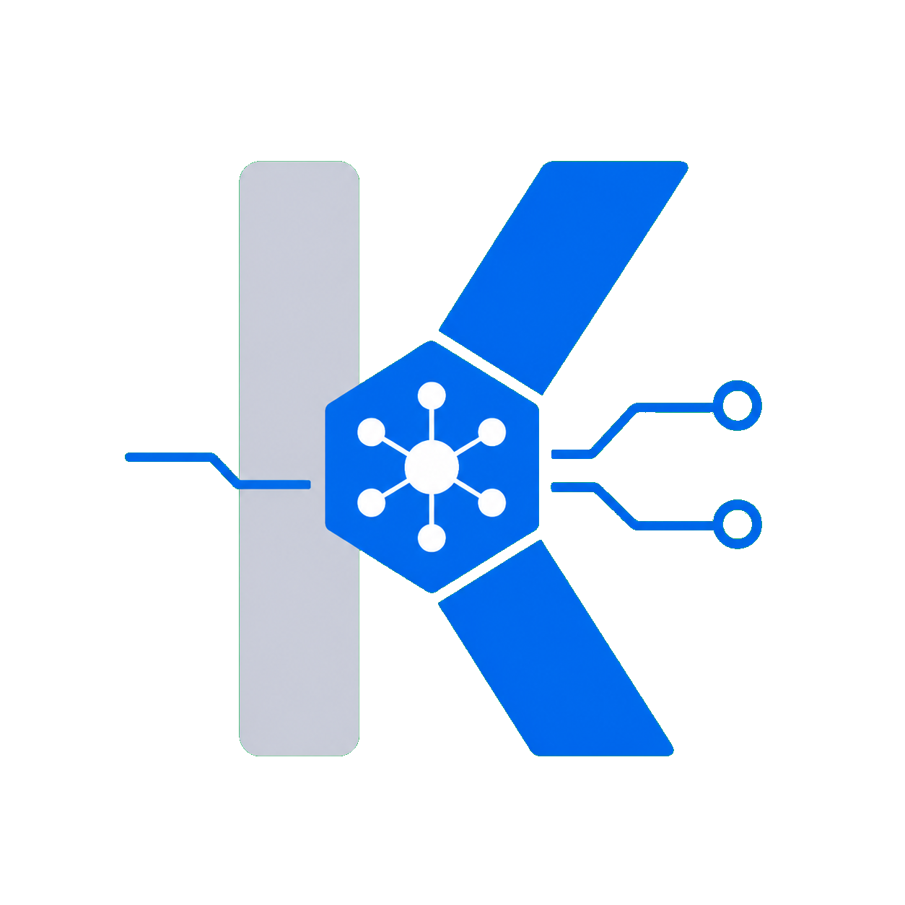

# Kemo Gateway

<a href="README.md">简体中文</a> · <strong>English</strong>

  

Kemo Gateway brings model services together for AI agents. Connect your providers once, give agents stable model names, and manage provider credentials, available models and usage policies in one place.

**[Documentation site](https://kesepain-ke.github.io/kemo-agent-doc/) · [Agent operations guide](agent/_doc/README.md)**

## What the gateway does

- **Connect model services**: bring hosted providers and local services together behind stable model names.
- **Manage credentials and access**: maintain provider keys, give each agent its own calling key, and set model access, rate limits and budgets.
- **Route model requests**: connect multiple sources to a model, set priorities and weights, and use available alternatives when a source fails.
- **Track actual usage**: inspect calls, success rates, tokens, costs and runtime status in the web console.
- **Support agent workflows**: normalize model capabilities, tool calls, streaming output and usage for Kemo agents and other compatible clients.
- **Connect media services**: carry images, audio, video and files through supported adapters for understanding, generation and result retrieval.

## Let an agent manage the gateway

An agent can help add providers, update upstream credentials, discover and register models, select available models, adjust routing, and create, edit or disable calling keys. It can also install user adapters and templates, update built-in resources independently, edit startup configuration and restart the gateway. The agent and the web console work with the same configuration, so changes can be checked in the console.

For any agent framework, start at **[agent/_doc/README.md](agent/_doc/README.md)**, the shared guide for controlling the gateway. The task guides explain how to connect, authenticate, inspect current state, make changes and verify the result, including concurrent edits, sensitive values and when changes take effect.

For example:

> Read the gateway agent operations guide. Add the model service and credential I provide, expose only my selected models, create a separate calling key for my agent, and verify the final configuration.

For installation, deployment and everyday use, start at the [documentation site](https://kesepain-ke.github.io/kemo-agent-doc/).
