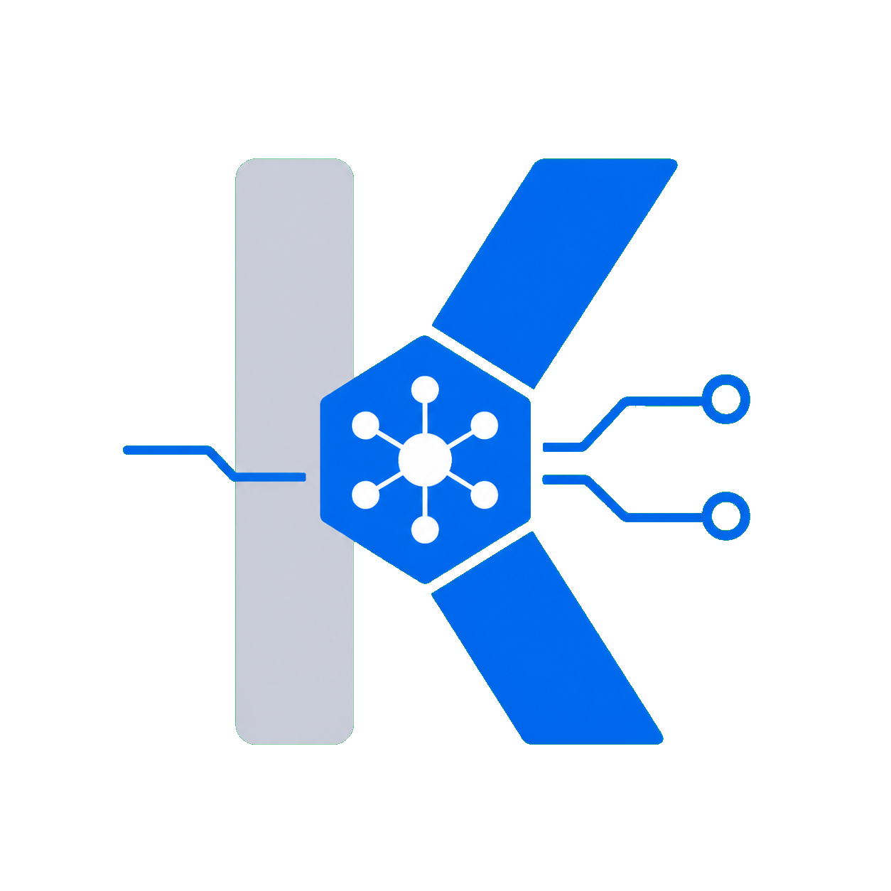

# Kemo Gateway

<strong>简体中文</strong> · <a href="README.en.md">English</a>

Kemo Gateway 为智能体统一管理模型服务。把不同提供商接入网关后，智能体使用统一的连接方式调用模型，用户可以集中维护提供商、密钥、可用模型与调用策略。

**[文档站](https://kesepain-ke.github.io/kemo-agent-doc/) · [智能体操作指南](agent/_doc/README.md)**

## 网关能做什么

- **统一接入模型服务**：集中连接不同提供商和本地模型服务，向智能体提供稳定的模型名称。
- **集中管理凭据与权限**：维护提供商密钥，为不同智能体分配调用密钥，控制可用模型、调用额度与预算。
- **安排模型路由**：为同一模型配置多个来源，调整优先级与权重，在来源不可用时使用其他可用连接。
- **查看实际使用情况**：在网页中查看调用记录、成功率、Token 用量、成本与运行状态。
- **适配智能体调用**：统一处理模型能力、工具调用、流式输出和用量，供 Kemo 智能体及其他兼容客户端使用。

## 让智能体管理网关

智能体可以直接帮助用户添加提供商、更新上游密钥、发现和添加模型、选择可用模型、调整路由，以及创建、编辑和停用调用密钥。也可以新增用户协议与模板、独立更新内置资源、维护启动配置并完成重启。网页控制台和智能体使用同一份网关配置，保存后可在网页中核对结果。

无论使用哪种智能体框架，都可以让智能体从 **[agent/_doc/README.md](agent/_doc/README.md)** 开始。这是智能体操控网关的统一手册，按任务说明连接与认证、读取当前状态、执行修改和验证结果，并说明并发修改、敏感信息及生效方式。

例如，可以这样交代任务：

> 读取网关的智能体操作指南，添加我提供的模型服务和密钥，只开放我选定的模型，为我的智能体创建一个独立调用密钥，并核对最终配置。

安装、部署和日常使用从 [文档站](https://kesepain-ke.github.io/kemo-agent-doc/) 开始。
